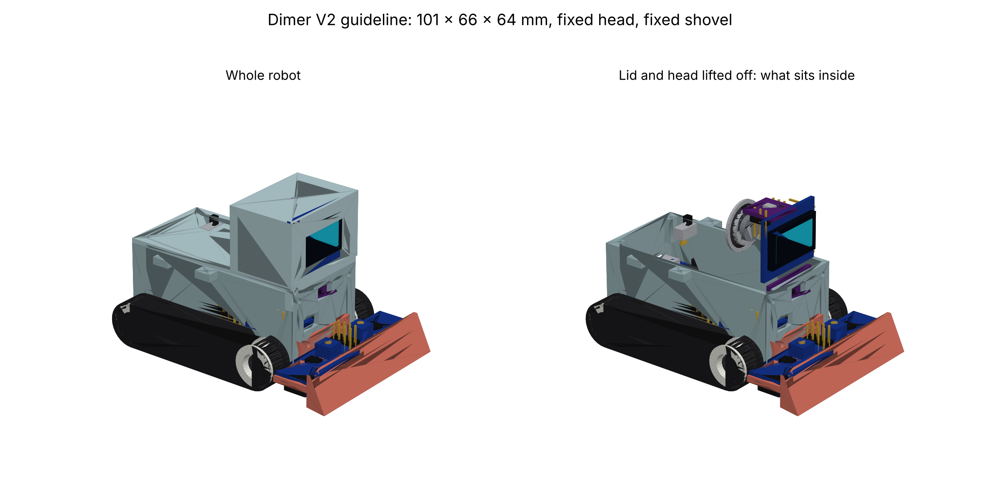
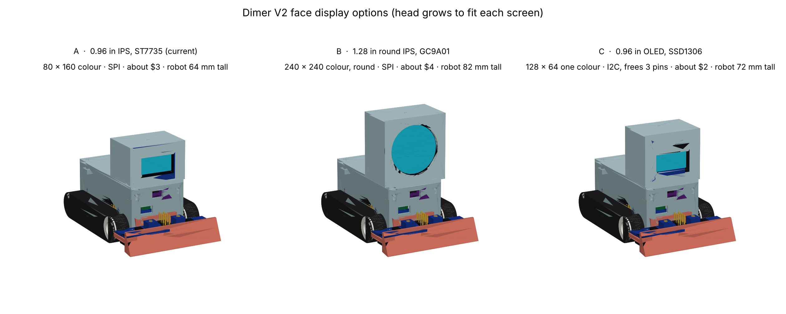

# Dimer V2 (half size)

A second, smaller Dimer. V1 in the folders above is unchanged and still builds on its own.

| | V1 | V2 |
|---|---|---|
| Size (L x W x H) | 197 x 144 x 118 mm | 114 x 66 x 66 mm (85 mm with the head tilted fully up) |
| Head | turns on a servo | sits low in front of the body, tilts up to 25 degrees on one micro servo |
| Camera | none | yes, above the display (brain and camera are one board in the head) |
| Shovel | lifts on a servo | fixed to the front |
| Battery | 2 x 18650 (7.4 V) | one flat 1S LiPo (3.7 V), boosted to 5 V |
| Electronics | custom main board | small modules joined by jumper wires |
| Tracks | bought track set | printed 22 mm wheels with a rubber band or TPU belt |
| Edge sensors | 4 | 2, front only |
| Parts cost | about $134 | about $57 |



| Folder | What is in it |
|---|---|
| `cad/` | `dimer_v2_frame.py` generates the four printed parts and places every bought part. It reuses the part models in `../cad/dimer_components.py`. `cad/step/` has one STEP per printed part, the full assembly, and `components/` with the parts V1 does not have. |
| `docs/` | `BOM.md` buying list, preview images, `drawings/` with the four-view A3 drawing (PDF, SVG, PNG), and `web/dimer_v2_build_plan.html`, the 3D build page (live at https://claude.ai/artifact/1GJJysHat3mT6KsMUrrWHj). |
| `firmware/` | `dimer_v2_pins.h` pin map for the XIAO ESP32S3 Sense. |

## Printed parts

- `v2_frame_chassis`: the tub. A tall bay at the back holds the battery, charger and boards. A low step at the front lets the head sit down close to the tracks. The tilt servo drops into a notch in the left wall.
- `v2_frame_top`: bay lid, the riser between bay and step, and the step plate, in one piece.
- `v2_frame_head`: holds the display, the camera brain above it, the speaker in the left cheek and the amplifier on its floor. Open at the back so your shell can close it. Two arms reach back to the tilt axis: the left arm bolts to the servo horn, the right arm turns on an M3 screw in the boss on the right wall.
- `v2_frame_shovel`: blade, plus the shelf that carries the two edge sensors. Two screws into the front wall.

## Where the camera is

The camera lens sits in the 8 mm round window centred 54 mm above the table, directly above the display, on the head's centre line. The microphone hole is 7.5 mm to its left. Keep both clear when you design the shell.

## Head tilt

The head turns about a horizontal axis 33.5 mm above the table, behind the head. Range 0 to 25 degrees up. The frame script checks for clashes with the head level, and you can check any angle with `DIMER_TILT=25 python v2/cad/dimer_v2_frame.py` (that run saves nothing). Run the head wires in a loop over the axis so they do not pull when it tilts.

## Things that differ from a plain 0.5x scale

- Two N20 motors do not fit end to end in a 34 mm wide body. One drives the rear left wheel, the other the front right wheel.
- The battery pocket takes at most 40 x 30 x 10 mm.

## Status

Rough guideline, same as V1. Part sizes are typical seller dimensions, so measure the real parts before final fits. The script checks that no bought part overlaps the frame or another part. Nothing is built or powered yet.

```
pip install cadquery
python v2/cad/dimer_v2_frame.py
```

## Face display options

Three screens to try. The head grows to fit each one, and the clash check passes for all three, level and tilted.

| Option | Screen | Head (W x H) | Robot height | Notes |
|---|---|---|---|---|
| `st7735_096` (default) | 0.96 in IPS, 80 x 160 colour, SPI | 40 x 43 | 66 mm | Rectangular colour face. |
| `gc9a01_128_round` | 1.28 in round IPS, 240 x 240 colour, SPI | 44 x 57 | 85 mm | One big round eye. The head is wider than the gap between the tracks, so it sits on top of them. |
| `ssd1306_096_oled` | 0.96 in OLED, 128 x 64 one colour, I2C | 40 x 49 | 72 mm | Classic robot-eye look. Uses the I2C wires, freeing three brain pins. |



Each option has its own head (`v2_frame_head.step`), the display model, and a full assembly in `cad/step/display_options/<option>/`. To make one, run:

```
DIMER_DISPLAY=gc9a01_128_round python v2/cad/dimer_v2_frame.py
```
