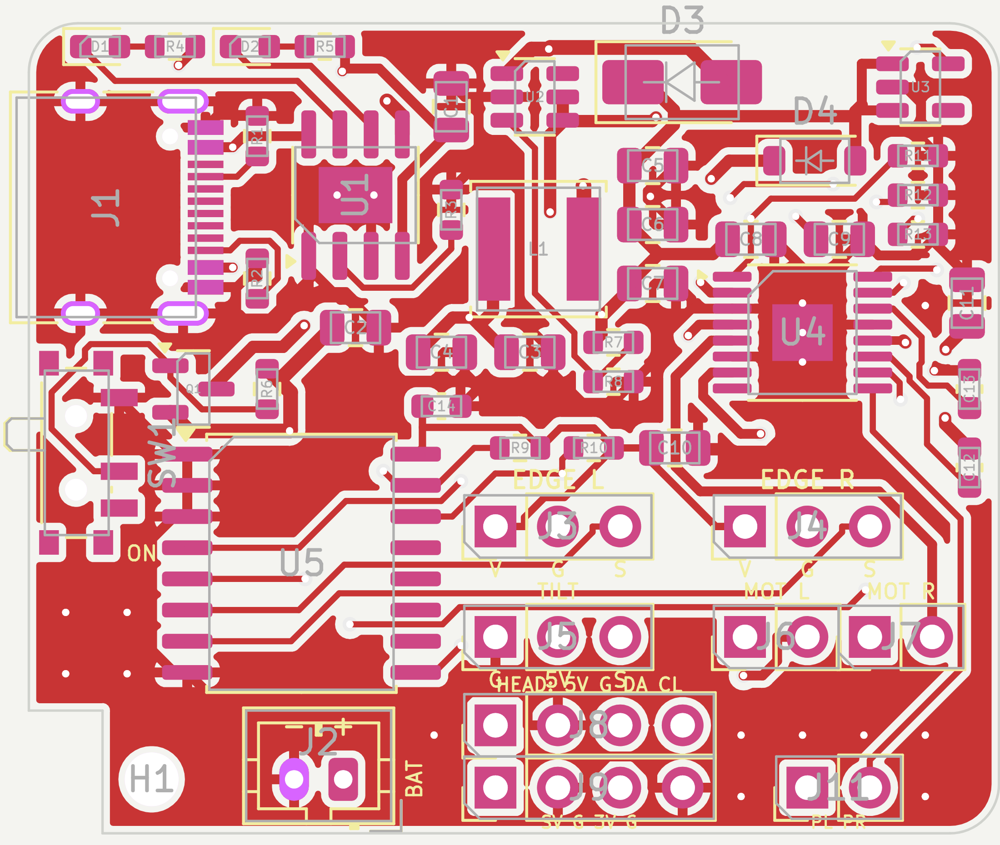

# Dimer V2 power board (r1)

One small board, made and fully soldered by JLCPCB, that replaces the charger module,
the slide switch, the DRV8833 module and the PCF8574 module of the first V2 list.
r1 includes the fixes from an outside design review (see the end of this page).
No power wiring to solder: the battery plugs in, USB-C and the switch are on the board.

| | |
|---|---|
| Size | 39.5 x 33 mm, 2 layers, 1.6 mm, one M2 screw hole |
| Where | Flat in the electronics bay at z = 20.2 mm, on two ledges of the side walls, above the battery and the left motor. One M2 x 6 self-tapping screw into the pillar at the rear right; two lips under the lid hold the front edge. |
| Battery | 1S LiPo with protection board and a JST PH 2.0 plug (`+` is marked) |
| Charging | USB-C on the rear wall, TP4056, about 0.4 A (2.5 h for 1000 mAh). Charge with the switch off: with the robot running the charger may not stop on its own. Red light = charging, green = full. You see them through two holes in the lid. |
| Switch | Slide switch in the rear wall slot (use a fingernail or a toothpick). It only drives a P-MOSFET (AO3401A), so it never carries motor current. |
| 5 V | MT3608 boost, about 1 A steady, with 66 uF of output capacitors for servo and Wi-Fi bursts: servo, XIAO brain, amplifier. The head gets it through a diode, so plugging USB into the XIAO cannot back-feed the board. |
| 3.3 V | AP2112K-3.3 from the 5 V: expander, edge sensors, I2C pull-ups |
| Motors | DRV8833 on the switched battery. It sleeps until the firmware wakes it, so the tracks cannot move at power-up. |
| Expander | PCA9534 at I2C address 0x20 (same pins as PCF8574T, but starts with every pin as an input): P0/P1 motor directions, P2/P3 edge sensors, P4 motor sleep, P5-P7 unused |

## Plugs (2.54 mm pins for jumper wires)

| Label | Pins | Goes to |
|---|---|---|
| HEAD (J8) | 5V, G, DA, CL | XIAO 5V (and the amplifier, with a splitter), GND, D4 (SDA), D5 (SCL) |
| SV G 3V G (J9) | SV, G, 3V, G | XIAO D2 (servo signal), GND for the head (screen and amplifier, with a splitter); 3V and G spare |
| PL PR (J11) | 2 pins | XIAO D0 (PWM left), D1 (PWM right) |
| TILT | G, 5V, S | SG90 servo plug (brown wire on G) |
| EDGE L / EDGE R | V, G, S | TCRT5000 VCC, GND, DO |
| MOT L / MOT R | 2 pins | N20 motor tabs (swap the two wires if a track runs backwards) |
| BAT | +, - | battery |

The firmware pin map is in `v2/firmware/dimer_v2_pins.h`.

## Files

| File | What it is |
|---|---|
| `dimer_v2_power_gerbers_JLCPCB.zip` | Upload this as the PCB |
| `dimer_v2_power_BOM_JLCPCB.csv` | Parts list for assembly |
| `dimer_v2_power_CPL_JLCPCB.csv` | Part positions for assembly |
| `dimer_v2_power.kicad_pcb` | The board, opens in KiCad 7 or newer |
| `drc_report.txt` | KiCad design-rule check of the routed board |
| `make_board_v2.py` | Builds all of the above (KiCad 7 + freerouting) |
| `board_parts_json.py` | Writes `dimer_v2_power_parts.json`, from which the frame script draws the board in the 3D model |

## Ordering at JLCPCB

1. Go to jlcpcb.com, **Order now**, and upload `dimer_v2_power_gerbers_JLCPCB.zip`. It reads 39.5 x 33 mm, 2 layers.
2. Keep the defaults: FR-4, 1.6 mm, HASL (lead free if you like), any colour. Quantity 5 or 10.
3. Turn on **PCB Assembly**. Choose **Standard** (the pin headers and the battery plug are through-hole, Economic does not do those), **Top side**, tooling holes **Added by JLCPCB**, and the same quantity.
4. Upload `dimer_v2_power_BOM_JLCPCB.csv` and `dimer_v2_power_CPL_JLCPCB.csv`.
5. On the parts page, pick a part for each row that has no match (see the list below). Search the text in the row's comment.
6. On the placement page, look at every chip and the two LEDs. The dot (pin 1) must sit on the marked corner. If one is turned the wrong way, rotate it there; JLCPCB fixes it before building.
7. Order. JLCPCB checks the files again and emails if anything is unclear.

### Parts to check on the parts page

LCSC is blocked from where this board was made, so no part number was checked live. These are the ones that need a look:

| Ref | Part | LCSC # in the BOM | What to do |
|---|---|---|---|
| U5 | PCA9534, SO-16 wide (PCA9534DWR) | none | Search `PCA9534DW`. Must be the 7.5 mm wide SO-16 package, not TSSOP. |
| L1 | 4.7 to 10 uH, 5 x 5 mm, saturation 3 A or more | none | Search `FNR5040S4R7` or `FNR5040S100`; pick the one with the higher saturation current (3 A or more). |
| SW1 | Slide switch PCM12SMTR | none | Search `PCM12SMTR`. A same-size SMD right-angle SPDT switch also works. |
| J2 | JST PH 2-pin vertical, B2B-PH-K-S | none | Search `B2B-PH-K-S`. |
| U1 | TP4056 (ESOP-8 with heat pad) | C16581 | Make sure the part shown has the heat pad (ESOP-8, not SOP-8). |
| U2 | MT3608 | C84817 | Make sure it says MT3608, SOT-23-6. |
| R7 | 75 k 0603 | C23242 | Any 1% 75 k 0603 works. |
| R3 | 3 k 0603 | C4211 | Any 3 k 0603 works. |
| U3 | AP2112K-3.3, SOT-23-5 | C51118 | Check it says AP2112K-3.3. |
| D4 | B5819W, SOD-123 | C8598 | Any 1 A Schottky in SOD-123 works. |
| C5-C7 | 22 uF 0805, 10 V or more | C45783 | Any 22 uF 0805 X5R works. |
| C13 | 2.2 uF 0603, 10 V or more | C23630 | Any 2.2 uF 0603 works. |
| R9, R10 | 4.7 k 0603 | C23162 | Any 4.7 k 0603 works. |
| J1 | USB-C 16P, TYPE-C-31-M-12 | C165948 | Should match; check the picture is a 16-pin USB-C. |

All other numbers (DRV8833 C50506, AO3401A C15127, SS34 C8678, the capacitors, the pin headers) are the ones the V1 board uses or are JLCPCB basic parts.

### Rough cost (USD, not a live quote)

| | 5 boards | 10 boards |
|---|---|---|
| Bare boards | 2 | 5 |
| Assembly setup + stencil (Standard) | 33 | 33 |
| Extended-part fees, about 10 parts at $3 | 30 | 30 |
| Parts, about $3 a board | 15 | 30 |
| Through-hole soldering, about 33 joints a board | 3 | 6 |
| Shipping (cheapest) | 10 to 20 | 10 to 20 |
| **Total** | **about $95 to $105, so $20 a board** | **about $115 to $125, so $12 a board** |

The fixed fees are most of the price, so more boards in one order are much cheaper each.

## Before the first power-up

1. Check the battery plug: red wire on `+`.
2. Plug in USB-C with no battery: nothing should get warm. With the battery: the red light comes on.
3. Switch on with nothing else plugged in and measure: 5V pin about 5.1 V, I2C 3V pin 3.3 V.
4. Then plug in the servo, the sensors, the motors and the head.

## Outside review (GPT-6 Astra, 17 Nov 2026) and what changed

| Finding | What r1 does |
|---|---|
| The PCF8574 starts with its pins high, so the motors could run backwards at power-up | Swapped to the PCA9534 (same pins and address, starts as inputs). Pull-downs on both direction lines, and the motor driver's sleep pin is on expander P4 with a pull-down: the tracks stay still until the firmware wakes them. |
| The XIAO's 5V pin is its USB power, so USB programming would back-feed the board | The head's 5 V goes through a B5819W diode. |
| 5 V bursts (servo, camera, Wi-Fi, speaker) | Output capacitors 3 x 22 uF instead of 3 x 10 uF, inductor rated 3 A or more. Measure the 5 V while the servo moves and the speaker plays before trusting it. |
| AMS1117 needs a big output capacitor to be stable | Swapped to AP2112K-3.3. |
| TP4056 runs hot at 0.6 A | Charge current 0.4 A. Charge with the switch off. |
| DRV8833 VINT capacitor should be 2.2 uF | Done. (Its fault line stays unconnected: there was no room to route it.) |
| Head power and ground need splitting | Three 1-to-3 dupont splitters in the buying list. |
| ST7735 reset pin is not driven | Firmware sends the software reset at start-up (noted in the pin map). |
| Not changed: a bigger boost chip (TPS61088), load sharing for the charger, rear edge sensors | Kept the board simple and cheap for the first build; revisit if the 5 V measurement shows dips. |
